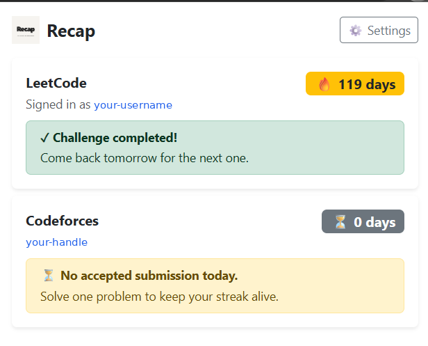
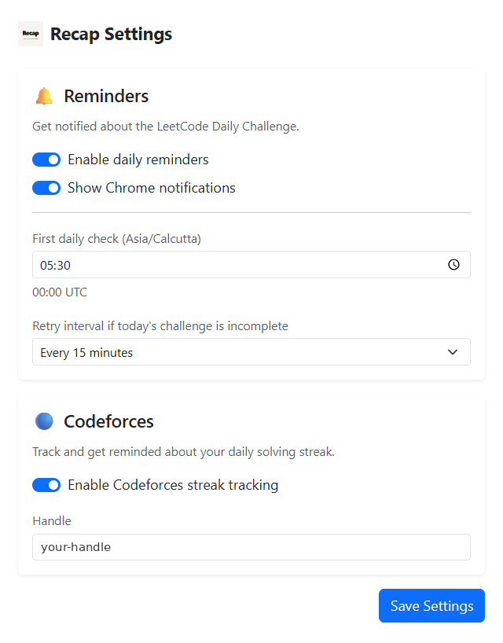

# Recap: LeetCode Daily Challenge Reminder Chrome Extension

Recap is a free, open-source Chrome extension that reminds you to solve the LeetCode Daily Challenge, shows whether today's problem is completed, and tracks your LeetCode and Codeforces streaks from the toolbar. Set your own reminder time and retry interval, then let Recap nudge you until the problem is solved.

[Website](https://anshukumar2932.github.io/Recap/) | [Documentation](docs/installation.md) | [FAQ](docs/faq.md)

<!-- IMAGE 1 (hero): popup showing today's problem, difficulty, tags, and streak. Size about 1280x800 or a tight 400x600 popup crop. -->

## Why use a LeetCode Daily Challenge reminder

The LeetCode Daily Challenge changes every day, and a missed day breaks your streak. Recap checks your LeetCode account at the time you choose and keeps reminding you at your chosen interval until the challenge is completed. Once it is solved, the reminders stop for the day.

## Features

- **LeetCode Daily Challenge tracker:** today's problem title, link, difficulty, and topic tags.
- **Completion status:** see at a glance whether you solved today's problem.
- **Smart daily reminders:** a first check at your local time, then retries every 15, 30, 60, or 120 minutes until you finish.
- **LeetCode streak counter:** your current streak in the popup navbar.
- **Codeforces streak tracking:** add your Codeforces handle to see your solving streak and whether you solved a problem today.
- **Settings page:** turn reminders and Chrome notifications on or off, and set the check time.
- **Sign-in detection:** shows your LeetCode username or prompts you to sign in.

<!-- IMAGE 2: settings page screenshot -->

See every feature in the [features guide](docs/features.md).

## Install

1. Add Recap from the [Chrome Web Store](ADD_CHROME_WEB_STORE_URL), or download the latest zip from [GitHub Releases](https://github.com/anshukumar2932/Recap/releases/latest).
2. Sign in to leetcode.com in Chrome.
3. Open the Recap popup and visit Settings to choose your reminder time.

Full steps, including building from source, are in the [installation guide](docs/installation.md). Recap works in Google Chrome and Chromium browsers that support Manifest V3.

## Documentation

| Guide | What it covers |
| --- | --- |
| [Installation](docs/installation.md) | Chrome Web Store, release zip, build from source |
| [Features](docs/features.md) | Reminders, streaks, Codeforces, settings |
| [Architecture](docs/architecture.md) | Popup, service worker, LeetCode GraphQL queries |
| [Permissions](docs/permissions.md) | Why each Chrome permission is needed |
| [Privacy](docs/privacy.md) | What data Recap reads and where it goes |
| [Development](docs/development.md) | Build, run, and contribute |
| [Troubleshooting](docs/troubleshooting.md) | Fixes for common problems |
| [FAQ](docs/faq.md) | Common questions |

## Built with

React, JavaScript, Chrome Extensions Manifest V3, Chrome Alarms, Notifications and Storage APIs, Webpack, Babel, the LeetCode GraphQL API, and the Codeforces API.

## Roadmap

More reminder customization, challenge history, and Chrome Web Store distribution. See [GitHub Releases](https://github.com/anshukumar2932/Recap/releases) for version history.

## Contributing

Bug reports, feature requests, and pull requests are welcome. Read the [development guide](docs/development.md) and run `npm run build` before opening a pull request.

## License

MIT. See [LICENSE](LICENSE).
