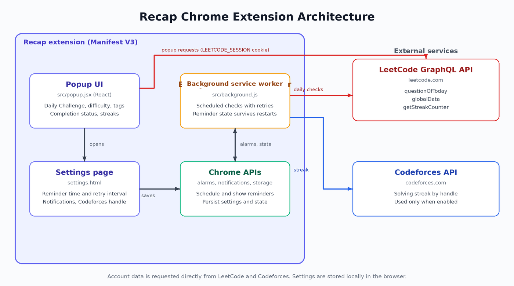

# Recap Architecture: Manifest V3, LeetCode GraphQL, and Chrome Alarms

Recap is a Manifest V3 Chrome extension built with React, JavaScript, Webpack, and Babel.

## Components

**Popup (`src/popup.jsx`):** the React interface. It requests the Daily Challenge, user status, and streak data, and renders Codeforces data when enabled.

**Background service worker (`src/background.js`):** schedules checks with Chrome alarms and shows Chrome notifications. Alarm scheduling is serialized, and reminder and failure state is persisted so it survives service-worker restarts.

**Manifest (`public/manifest.json`):** declares permissions, the popup, the service worker, and icons.

## LeetCode GraphQL queries

| Query | Purpose |
| --- | --- |
| `questionOfToday` | Daily Challenge, `userStatus`, difficulty, topic tags |
| `globalData` | Signed-in status and username |
| `getStreakCounter` | `streakCount`, `daysSkipped`, `currentDayCompleted` |

Account-specific queries need the `LEETCODE_SESSION` cookie, read through the `cookies` permission and sent as a request header.

## Reminder flow

```text
Alarm fires at configured time -> fresh LeetCode request
  -> completed: stop retries, schedule next day
  -> incomplete: notify, retry after 15/30/60/120 minutes
  -> HTTP error or invalid response: counted as a failed check
```

Codeforces runs on a separate alarm and uses the Codeforces API with the handle from Settings.

<!-- IMAGE (optional): architecture diagram of popup, service worker, LeetCode API, Codeforces API -->


## Project structure

```text
public/            manifest.json and icons, copied to dist/
src/popup.jsx      React popup UI
src/popup.html     Popup entry HTML
src/background.js  Service worker (alarms and notifications)
webpack.config.js  Shared config
webpack.dev.js     Dev build (watch mode)
webpack.prod.js    Production build
.babelrc           Babel presets (env, react)
```
