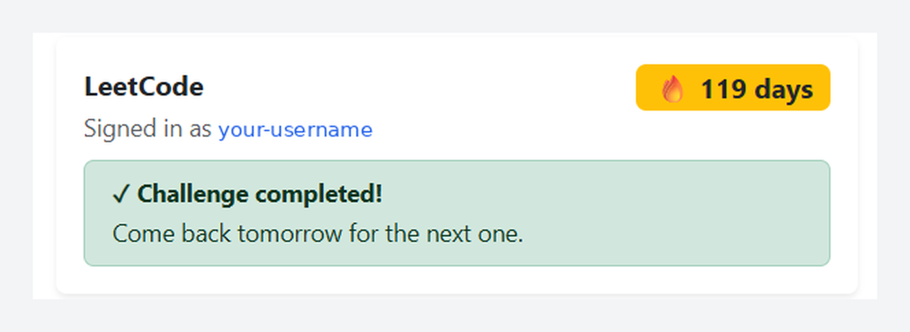
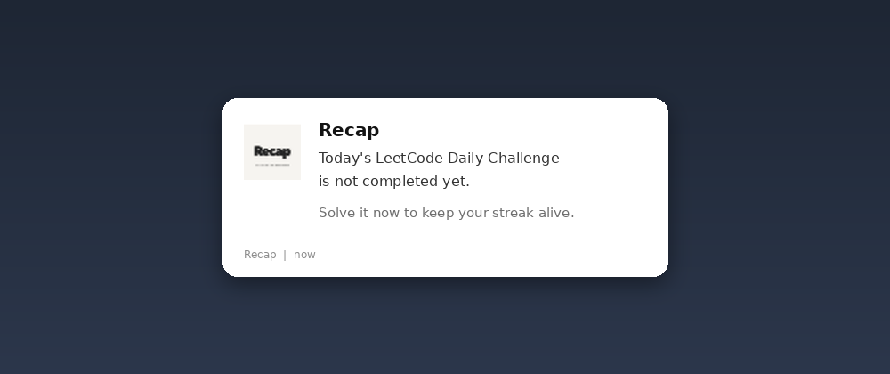
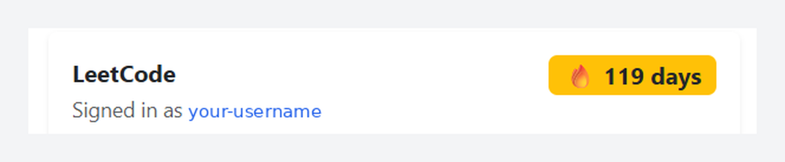
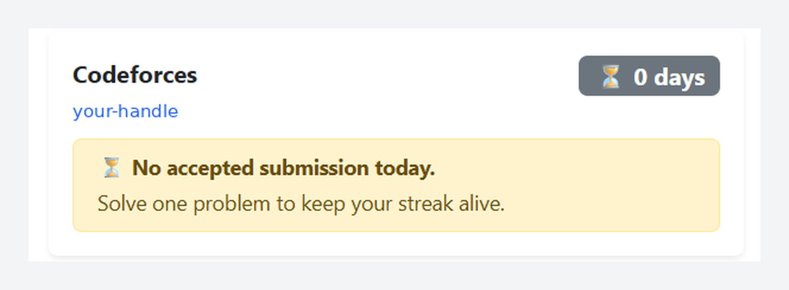

# Recap Features: LeetCode Reminders, Streaks, and Codeforces Tracking

## LeetCode Daily Challenge

Recap fetches today's Daily Challenge and shows the title, a direct link, the difficulty (Easy, Medium, or Hard), and topic tags such as arrays, graphs, or dynamic programming.

## Completion status

Recap reads your LeetCode user status and shows whether the Daily Challenge is completed, so you can answer "Did I solve today's LeetCode problem?" in one click.

## Reminders with retries

1. Recap checks LeetCode at your chosen time in your local timezone.
2. If the challenge is incomplete, it retries every 15, 30, 60, or 120 minutes.
3. When you complete it, the retry loop stops.
4. The next check is scheduled for the following day.

Every check makes a fresh request to LeetCode, and reminder state survives Manifest V3 service-worker restarts.

## LeetCode streak counter

Your current streak appears in the popup navbar, along with whether today is completed and how many days were skipped.

## Codeforces streak tracking

Enable Codeforces in Settings and enter your handle. The popup then shows your handle, your current solving streak, and whether you have an accepted submission today. Codeforces reminders use their own background alarm, independent from LeetCode.

## Settings page

- Enable or disable daily reminders.
- Choose the first daily check time.
- Choose the retry interval (15, 30, 60, or 120 minutes).
- Enable or disable Chrome notifications.
- Enable Codeforces tracking and set your handle.

## Sign-in detection

Recap shows your LeetCode username with a profile link, or prompts you to sign in.

Related: [architecture](architecture.md), [permissions](permissions.md), [FAQ](faq.md).
