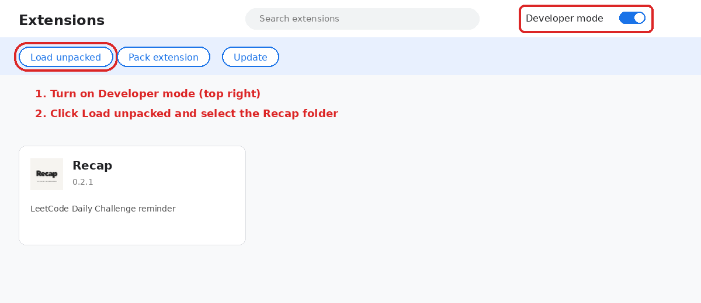

# How to Install the Recap LeetCode Chrome Extension

Recap installs in under a minute. Choose the method that fits you.

## Option 1: Chrome Web Store

<!-- 1. Open the [Recap listing](ADD_CHROME_WEB_STORE_URL).
2. Click Add to Chrome and confirm.
3. Pin Recap from the Chrome extensions menu.
4. Sign in to leetcode.com, then open the Recap popup. -->
Coming Soon !!!

## Option 2: Download a GitHub release

1. Download `Recap-v0.2.1.zip` (or newer) from [GitHub Releases](https://github.com/anshukumar2932/Recap/releases/latest).
2. Unzip it to a folder.
3. Open `chrome://extensions` and enable Developer mode.
4. Click Load unpacked and select the unzipped folder.

<!-- IMAGE: chrome://extensions with Developer mode and Load unpacked highlighted -->



## Option 3: Build from source

Requirements: Google Chrome, Node.js, npm.

```bash
git clone https://github.com/anshukumar2932/Recap.git
cd Recap
npm install
npm run build
```

Load the generated `dist/` folder with Load unpacked.

## After installing

1. Sign in to leetcode.com.
2. Open Recap and go to Settings.
3. Choose your daily check time and retry interval.
4. Optional: enable Codeforces tracking and enter your handle.

Having trouble? See [troubleshooting](troubleshooting.md).
